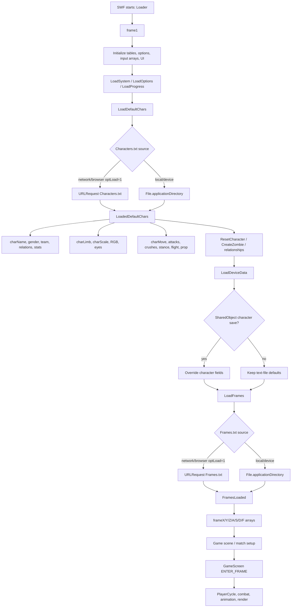
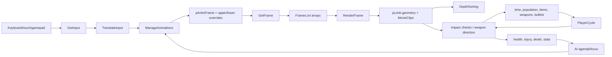

# Data Flow and Dependencies

**Scope:** how Extra Lives 1.170.64 moves data from the APK's external text files and SWF asset classes into runtime simulation, saves, rendering, and combat.

**Evidence:** intact official APK/SWF, decompiled `Game_fla/MainTimeline.as`, canonical repository data files. Static analysis only.

## 1. Data layers

The runtime can be divided into five layers:

| Layer | Examples | Lifetime | Authority |
|---|---|---|---|
| Static content | `Characters.txt`, `Frames.txt`, SWF sprites/sounds/fonts, code tables | Shipped, immutable | Content |
| Persistent local state | `SharedObject` saves, edited characters, progress, options | Across launches | Client/device |
| Match/world state | characters, positions, health, relationships, teams, stocks, clock | One session/save | Local simulation |
| Derived state | limb transforms, display depths, `pScale`, `pStat`, stat modifiers | Recomputed frequently | Simulation |
| Presentation state | MovieClips, frame labels, colors, sounds, particles, UI | Display list | Client-local |

Only the first three contain durable logical information. The last two should not be transmitted as network state.

## 2. Canonical external data

| File | Size | SHA-256 | Role |
|---|---:|---|---|
| `assets/Characters.txt` | 211,581 | `7acb482fc4f540a33bd2df382cc31e8f0ab392f4ff4e832e7376290b7cec6ec1` | 200 character definitions |
| `assets/Frames.txt` | 320,860 | `850e753965907c73e69dfae5e5e2f7726c5405f296ab8078f5ae4a758d956538` | 1,401 limb-pose records |

Repository paths:

```text
assets-research/extralives/apk-extracted/assets/Characters.txt
assets-research/extralives/apk-extracted/assets/Frames.txt
```

Both are byte-identical to the copies in the intact official APK. The repository's `Game.swf` is corrupt, but that does not affect these text assets.

## 3. Startup data flow



### Exact startup characteristics

- `LoadDefaultChars` resolves `Characters.txt` from `File.applicationDirectory` or `URLRequest`, depending on `optLoad`.
- `LoadedDefaultChars` parses all records and calls `LoadDeviceData` before `LoadFrames`.
- `LoadDeviceData` may override loaded character fields from local `SharedObject`s.
- `LoadFrames` runs only when `loadedFrames == 0`.
- The loading screen can call `LoadFrames` as a fallback if it has not loaded.
- `Frames.txt` and `Characters.txt` do not reference each other by explicit IDs.

**Verified.**

### Why load order matters

The character file is loaded first because character data supplies the roster and costume knowledge. Frame data supplies poses later. However, character behavior IDs (`charMove`, `charAttack`, etc.) can only resolve to actual poses after `Frames.txt` is available and the animation state machine runs.

Neither file can be reconstructed from the other.

## 4. `Characters.txt` data flow

### Loader to arrays

```text
Characters.txt
  -> LoadedDefaultChars
  -> charName[1..200]
  -> charGender / charTeam
  -> charPartner / charLover / charFriend / charEnemy
  -> charStat[1..6]
  -> charScale[costume][limb]
  -> charLimb[costume][limb]
  -> charR/G/B[costume][limb]
  -> charEyes[costume]
  -> charMove[1..9]
  -> charGroundMove[1..2][1..2]
  -> charAttack[1..5]
  -> charCrush[1..5]
  -> charStance[1..2]
  -> charTrigger / charFlight / charProp
```

The full layout is documented in [CHARACTERS-TXT-ANALYSIS.md](CHARACTERS-TXT-ANALYSIS.md).

### Identity and relationships

- Character identity is the **ordinal position** in the file, `1..200`.
- Names are display strings, not stable keys.
- Relationship fields contain target ordinals.
- `AssumeRelationships` converts partner/lover/friend/enemy into runtime relationship values.
- `GenerateRelationships` may add random links under `optRestore > 0`.
- Local save data can override the relationship matrix as well as the character fields.

A system that reorders records or merges modded character files silently retargets relationships and saves.

### Costume to SWF assets

Each character has two costume blocks. Body limb IDs select entries in these code-defined arrays:

```text
charLimb[char][costume][limb]
  -> limbCostume[limb]
  -> SWF MovieClip class (Hips01, Head12, ...)
```

The arrays are initialized in `MainTimeline`:

| Limb | Array family | Array entries | Valid body IDs in data |
|---:|---|---:|---:|
| 1 | Hips | 23 | 1–22 |
| 2 | Body | 15 | 1–14 |
| 3 | Head | 124 | 1–116 |
| 4 | Right Thigh | 18 | 1–17 |
| 5 | Right Shin | 23 | 1–22 |
| 6 | Left Thigh | 18 | 1–17 |
| 7 | Left Shin | 23 | 1–22 |
| 8 | Right Shoulder | 17 | 1–16 |
| 9 | Right Forearm | 9 | 1–8 |
| 10 | Right Hand | 9 | 1–8 |
| 11 | Left Shoulder | 17 | 1–16 |
| 12 | Left Forearm | 9 | 1–8 |
| 13 | Left Hand | 9 | 1–8 |

The first array entry is `EmptyClip`; data IDs are one-based. All canonical body IDs are valid. The loader substitutes `1` for out-of-range body IDs.

Accessory IDs (limbs 14–32) select hair, sleeves, wristbands, body accessories, shoes, shorts, hip patterns, shirts, gloves, headwear, and beards. They use separate maxima and mostly zero-means-none. See the character analysis for the full table.

### Costume to rendering

```text
charScale[costume][limb] + global pScale
  -> limb scale and character size
charR/G/B[costume][limb]
  -> Flash ColorTransform multipliers
charEyes[costume]
  -> eyebrow/face frame and demeanour
charLimb[costume][limb]
  -> limb clip class and variant
```

`charScale[0]` is copied into `pScale`, which affects both rendering and hit geometry. `charScale[2][0]` is overwritten from costume 1's global scale.

### Behavior IDs to code tables

| Character field | Consumer/table | Result |
|---|---|---|
| `charStance` | `libStance` | animation IDs `1, 2, 133, 134, 135, 141` |
| `charMove` | move/animation logic | grapple/throw animation IDs in the `210..382` space |
| `charGroundMove` | ground-move libraries | ground move IDs in `412..437` |
| `charAttack` | attack logic, `ChangeAnim` | strike animation IDs in `1001..1319` |
| `charCrush` | crush/finisher logic | finisher IDs in `1201..1312` |
| `charTrigger` | projectile/trigger logic | special trigger IDs `0..20` |
| `charFlight` | flight/transformation logic | None/Jump/Extended Arms/Missile/Wings |
| `charProp` | weapon assignment | preferred weapon type `0..90` |

These IDs are not direct `Frames.txt` indexes. They enter the animation state machine, which then selects frame indexes.

## 5. `Frames.txt` data flow

### Loader to arrays

```text
Frames.txt
  -> FramesLoaded
  -> frameX[frame][limb]
  -> frameY[frame][limb]
  -> frameZ[frame][limb]
  -> frameA[frame][limb]
  -> frameS[frame][limb]
  -> frameD[frame][limb]
  -> frameF[frame][limb]
```

`frameF` is a **limb subframe selector**, not a global animation index. It also selects bind angles/distances for children of the hips/body. The full semantics are in [FRAMES-TXT-ANALYSIS.md](FRAMES-TXT-ANALYSIS.md).

### Selection path

```text
ManageAnimations
  -> pAnimFrame / pLowerFrame / pUpperFrame / pLimbFrame
  -> GetFrame(cyc, limb)
  -> frame index f
  -> frameX/Y/Z/A/S/D/F[f][limb]
  -> RenderFrame
  -> pLimbX/Y/Z/A/S
  -> limb MovieClip transform + gotoAndStop
```

`GetFrame` chooses the active frame per limb, with upper/lower-body splitting and explicit per-limb overrides. The resulting index is then used for all seven fields.

### Render to gameplay

`RenderFrame` is not merely cosmetic:

- `pLimb[3].y` (head height) is used by impact checks.
- Runtime attack origins come from limb positions.
- `frameD` is read directly for weapon direction.
- `charScale` scales limb offsets and hit ranges.
- Some `frameF` values branch in gameplay logic (head/body subframe checks).

Changing pose data can therefore change where an attack lands. The frame table is an executable part of the gameplay model.

### Depth

```text
pZ * 1000 + pLimbZ + frameZ
  -> displayZ
  -> DepthSorting
  -> MovieClip child index
```

`DepthSorting` is a painter's algorithm. It determines draw order, not collision.

## 6. Runtime per-tick data flow



### System order

A simplified `GameScreen` tick:

1. time/clock/frame-rate
2. camera/lighting
3. world systems (cages, cells, vehicles, atmosphere, animals)
4. gestures and population spawn rolls
5. player simulation and rendering (`PlayerCycle`)
6. items, weapons, tunnels
7. bullets, explosions, spurts, pools
8. health/clock UI
9. promotions/world social logic
10. depth sort
11. win/death checks

This order is a dependency graph, not arbitrary presentation:

- Camera state can affect render coordinates.
- Spawn rolls can add active entities before player updates.
- Players can create projectiles consumed later in the same tick.
- Combat can alter health/relationships consumed by promos/win checks.
- Render updates limb geometry used by combat in the same tick.

## 7. Save-data flow

### Character save override

```text
SharedObject Characters / Time_Characters
  -> LoadDeviceChars
  -> override name/gender/team/stats/costume/limbs/scales/RGB/eyes
  -> override moves/attacks/crushes/stances/trigger/flight/prop
  -> override relationships
```

This happens after the text file load. Two installations with identical `Characters.txt` can therefore have different character stats, appearances, moves, and relationships.

### Progress and options

| Save | Data | Runtime effect |
|---|---|---|
| `System` | version, boot count, flags, logs | startup/debug/purchase state |
| `Options` | display, controls, frame rate, multiplayer mode | loop timing, input mapping, local slots |
| `Calibration` | touch/controller calibration | input translation |
| `Progress` | main world/progress | campaign state |
| `Time_Progress` | Time Machine world/progress | alternate world state |
| `Characters` | character overrides | roster/gameplay data |
| `Time_Characters` | Time Machine roster overrides | alternate roster |

Saves are local and client-owned. They are not server-authoritative and can be edited.

### Save-back

- `SaveDefaultChars` serializes character arrays back into the pipe-delimited schema.
- The editor can modify character records before a match.
- World stocks (animals, items, weapons, tunnels) are also saved locally.
- There is no cloud sync, account identity, or server validation.

## 8. Dependency matrix

| Source | Depends on | Why |
|---|---|---|
| `Characters.txt` loader | code layout/order | positional schema |
| Relationships | character ordinals | target IDs |
| Costumes | SWF `limbCostume` arrays | limb symbol classes |
| Colors | SWF limb artwork | ColorTransform multipliers |
| Animation IDs | `ManageAnimations` tables | action semantics |
| `Frames.txt` | code field order | positional pose data |
| Rendering | Character costume + Frame pose + camera | composite sprite |
| Combat | Render-derived limb geometry + stats + weapons | hit positions/range |
| AI | relationships, teams, health, distance, RNG | target/action choice |
| Saves | character/world schema and ordinals | local persistence |
| Multiplayer (future) | all logical state above | authority/replication |

## 9. Content-integrity implications

For any future networked or replay feature:

1. **Hash both text files.** They are small and directly affect gameplay geometry.
2. **Preserve ordinal identity.** Reordering characters retargets relations/saves.
3. **Do not trust local character saves.** They can override virtually all static fields.
4. **Treat `Frames.txt` as shared immutable content.** Clients must not negotiate pose data casually.
5. **Version the content manifest.** Data changes can alter hit geometry even when code is unchanged.
6. **Reject mixed content in competitive sessions** unless differences are intentional and validated.

A minimal manifest:

```text
app_version
swf_sha256
characters_sha256
frames_sha256
content_schema_version
```

## 10. Network-facing conclusions

The game's data model is **content plus a large mutable world**, not a compact entity/component design.

For online play:

- Send logical runtime state, never MovieClips or whole SWF objects.
- Recompute limb geometry from shared content and synchronized pose state where possible.
- Synchronize character identity/costume/action state, not all 91 frame numbers.
- Host-authoritative simulation avoids requiring clients to reproduce RNG and frame-derived combat geometry.
- Replicate active-area entities at high frequency; world/social state at low frequency or on transition.
- Keep local saves and presentation outside the authoritative state boundary.

## 11. Open questions

1. Does `LoadDeviceChars` override every field or only fields present in the save? **Partially verified:** many fields are individually checked for null before override; a full matrix would require exhaustive tracing.
2. Can a client run with a modded `Frames.txt` without changing combat? **Strong inference no:** pose data feeds hit geometry.
3. Are character records ever referenced by name in save data? **Evidence points to ordinal arrays; needs exhaustive save schema trace.**
4. How much of the 200-character world state is persisted versus regenerated from relationships/teams? **Needs deeper world-state tracing.**
5. Does the editor permit saving values outside the runtime clamps (for example, hair ID > 89)? **Open.**

## 12. Evidence index

| Subject | Lines / symbols |
|---|---|
| `LoadDefaultChars` | `19700` |
| `LoadedDefaultChars` | `19717` |
| `LoadFrames` | `13895` |
| `FramesLoaded` | `13913` |
| Character costume parsing | `19780..19830` |
| Limb costume arrays | `110610..110633` |
| Accessory maxima | `110633..110644` |
| `LoadDeviceData` | `3108` |
| `LoadDeviceChars` | `19919` |
| `SaveDeviceChars` | `20516` |
| `RenderFrame` | `14003` |
| `GetFrame` | `14572` |
| `DepthSorting` | `14549` |
| `GameScreen` | `105575` |
| `PlayerCycle` | `21348` |
| `ManageAnimations` | `23540` |
| `FindImpacts` | impact checks around `53459` |
| `frameD` weapon direction | `75001`, `75029` |

See [FRAMES-TXT-ANALYSIS.md](FRAMES-TXT-ANALYSIS.md), [CHARACTERS-TXT-ANALYSIS.md](CHARACTERS-TXT-ANALYSIS.md), and [DETERMINISM-AND-GAME-LOOP.md](DETERMINISM-AND-GAME-LOOP.md) for the detailed evidence behind these paths.
