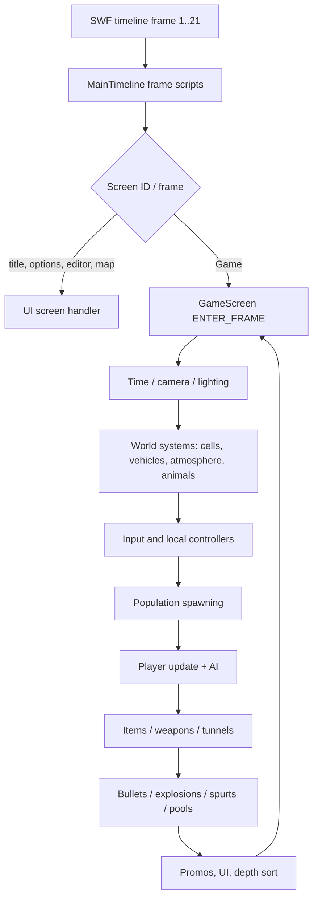
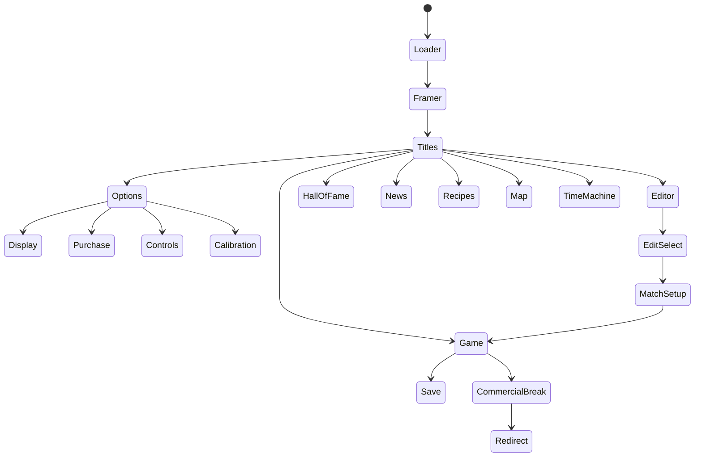
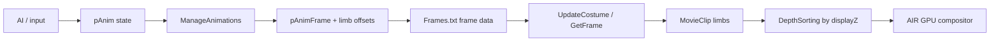

# Game Architecture

## High-level model

Extra Lives is a timeline-hosted, single-threaded, 2.5D sprite simulation. The SWF timeline provides 21 scenes; `Game.fla.MainTimeline` owns nearly all state and behavior. Gameplay is updated once per `ENTER_FRAME` tick, with no separate physics or network thread.



**Verified:** the screen handlers are attached with `addEventListener(Event.ENTER_FRAME, ...)` on the scene frames. `GameScreen` is the gameplay handler. **Strong inference:** the simulation is intended to run at the configured frame rate, with speed-up implemented by changing `stage.frameRate` and time-loop multipliers rather than by accumulating a fixed timestep.

## Startup and scene flow

1. The SWF starts at scene `Loader` (frame index 0). `MainTimeline`'s constructor registers frame scripts for indices 0–20.
2. `frame1()` initializes the game tables, options, input arrays, saves, and loader visuals.
3. `LoaderScreen` advances to `Framer`; `FramerScreen` handles resolution/layout.
4. The title screen (`TitleScreen`) exposes menus such as **Survival**, **Deathmatch**, and **Editor**.
5. Selecting a mode eventually loads the `Game` scene (frame index 12, `GameScreen`). Other scenes handle options, purchase/billing, controls, calibration, recipes, news, hall of fame, editor, match setup, save, map, time machine, commercial break, and redirect.



The arrows are the **observed scene/handler relationships**, not an exhaustive transition table. Many transitions are conditional and are implemented inside menu branches and `frame21()` routing rather than a declarative state machine.

## Match model

`GameScreen` distinguishes battle modes through `gamMode`:

- `gamMode == 0` — **Deathmatch / battle** behavior.
- `gamMode > 0` — **Survival** behavior.

The title menu exposes **Survival** and **Deathmatch**, and the conditionals across AI, spawning, and UI consistently use `gamMode` to distinguish them. The exact assignment of every mode value is not represented by a formal enum, so this mapping is a strong inference rather than a typed API.

### Players and entities

A player is not a class instance. A slot `cyc` maps into dozens of parallel arrays:

| Array family | Examples | Meaning |
|---|---|---|
| Identity | `pChar`, `pCostume`, `pZombie` | character record, costume, zombie state |
| Transform | `pX`, `pY`, `pGround`, `pZ`, `pAngle` | world position, ground height, facing |
| Animation | `pAnim`, `pAnimFrame`, `pAnimTim`, `pLowerFrame`, `pUpperFrame` | state machine and limb frames |
| Control | `pControl`, `pController`, `pGamepad`, `pActive` | human/AI/local controller assignment |
| Health/combat | `pHealth`, `pInjured`, `pDead`, `pAttack`, `pBlock` | damage and action state |
| Social | `pFoc`, `pAgenda`, `pAnger` | AI focus/agenda |
| Limbs | `pLimb*` arrays | per-limb pose, wounds, and offsets |

`AddPlayer` (line 20797) creates the entity, attaches its sprite, and initializes state. `LoadPlayer` (line 20996) configures the slot from the selected character. `PlayerCycle` (line 21348) iterates active slots and applies control, AI, animation, and physics-ish updates.

### AI

`AI(cyc)` (line 11622) is an agenda/focus system, not a pathfinding library:

- chooses a focus target (nearest entity, random opponent, threat, desirable object);
- reacts to anger, aggression, relationships, and match state;
- chooses attacks based on viability and distance;
- uses randomness scaled by player count and promo state.

Movement and animation are then handled by `ManageAnimations`, which reads the AI's chosen animation/action state.

### Animation and rendering

- `ManageAnimations` (line 23540) is a ~34.7k-line state machine. It handles stance, walking/running, climbing, jumping, grappling, attacks, injury, vehicles, and special cases.
- `Frames.txt` stores the actual limb poses for 1,400 frames. `GetFrame` selects upper/lower body frames and applies per-character scale/limb/accessory data.
- Each visual entity is registered with `LogEntity(sprite, displayZ)`. `DepthSorting` (line 14549) sorts entities by `displayZ` and calls `setChildIndex` so nearer objects render above farther ones.
- This is a **2.5D painter's algorithm**, not a 3D renderer. The project uses Flash/AIR GPU rendering of 2D sprites.



### World and maps

There are **64 areas** (`no_areas = 64`, assigned at line 112150). Each area has parallel arrays:

- `mapName`, `mapWidth`, `mapHeight`, `mapHorizon`, `mapAtmos`;
- `mapPopulation` = `Math.round(mapWidth / 150)` (line 112169);
- `mapBoard`, `mapSegment`, `mapFormation`, `mapWaves`, `mapKeeper`, `mapBoss`, `mapThreat`;
- map background/board sprite frames.

The 64 names are:

```text
0 Afterlife, 1 Junction, 2 Classroom, 3 Sewer, 4 Subway, 5 Bathroom,
6 Library, 7 School Yard, 8 Cafeteria, 9 Church, 10 Elevator, 11 Hospital,
12 School, 13 Train, 14 Prison, 15 Prison Yard, 16 Gym, 17 Dojo,
18 Time Machine, 19 Spaceship, 20 Office, 21 Aircraft, 22 Hanger, 23 Desert,
24 Snow, 25 Rooftop, 26 Gates, 27 Furniture Store, 28 Suburbs, 29 Street,
30 Arena, 31 Forest, 32 Beach, 33 Chinatown, 34 Electronics Store,
35 Sports Store, 36 Car Park, 37 Bar, 38 Store, 39 Docks, 40 Bedroom,
41 North Coast, 42 North East Coast, 43 Swamp, 44 South East Coast,
45 South Coast, 46 South West Coast, 47 Cave, 48 North West Coast,
49 Courtyard, 50 Temple, 51 Ocean, 52 Railway, 53 Cemetery, 54 Lodge,
55 Fair, 56 Arcade, 57 Farm, 58 Barn, 59 Park, 60 Mansion,
61 Police Station, 62 Factory, 63 Court, 64 Bridge
```

`LoadWorld` (line 58333) creates `BGClip`, jumps to the area background frame, reads the area dimensions/horizon, centers the camera, and builds the active scene. The stage is logical `700 × 400`; world dimensions are larger and camera zoom/follow handles the difference.

### Population and simulation boundary

The game tracks **200 character records** (`no_chars = 200`) across the world. Off-screen characters are not fully physically simulated:

- **Active area:** full entity simulation, AI, collision, animation, items, and combat.
- **Off-screen:** characters have a `charLocation`, relationships, teams, equipment, and inventory; relocation/probability logic moves them between areas. For example, `ManagePromos` and related world logic can relocate NPCs, send followers to the player's area, or stage confrontations.

This is a **strong inference** from relocation code and population checks. It is the correct mental model for any network design: the game state is global, but the high-frequency simulation is local to the current area.

### Camera and lighting

`ManageCamera` (line 58951) follows `camFoc` (normally the player, or a promo focus), supports zoom (`camZoom`), and multi-player framing. `ManageLighting` (line 58762) handles area/time lighting. `ManageAtmos` (line 5071) drives atmosphere, and `ManageTime` (line 100814) advances the clock and can raise the frame rate for speed-up.

### Persistence

The game persists to local `SharedObject`s, not to a server:

| Object | Key data | Code |
|---|---|---|
| `System` | version, boot count, PPV/hack flags, time/date logs | `LoadSystem` (3139) |
| `Options` | options, controls, multiplayer setting | `LoadOptions` / `SaveOptions` (3261 / 3362) |
| `Calibration` | input calibration | scene handler |
| `Progress` | main save slot | `LoadProgress` / `SaveProgress` (3389 / 3529) |
| `Time_Progress` | Time Machine save slot | same functions, different `screenAgenda` |
| `Characters` | main character data | `LoadDeviceChars` / `SaveDeviceChars` (19919 / 20516) |
| `Time_Characters` | Time Machine character data | same functions |

`LoadDeviceData` (3108) loads both the Time Machine and main slots. The game also saves stocks (animals, items, weapons, tunnels) as part of the device state. There is no cloud save or account identity in the analyzed code.

### Input and local multiplayer

Input sources are keyboard, touch/gesture, and gamepads. `GetInput`, `TranslateInput`, and `FindGestures` transform device input into per-player actions. Up to four local slots are supported through `pControl`, `pController`, and `pGamepad`.

`optMultiplayer` has four labels (`textMultiplayer`, line 110117):

```text
Off, Versus, Co-op, Mystery
```

The local multiplayer path is gated by `optGamepad > 0`. With Versus, a second local human is added as an opponent; Co-op adds a human ally; Mystery chooses a human using role logic. This is same-device play and is documented in detail in [NETWORKING-AND-MULTIPLAYER-FEASIBILITY.md](NETWORKING-AND-MULTIPLAYER-FEASIBILITY.md).

## Simulation characteristics relevant to refactoring

- **Verified:** the simulation is frame-driven and state is centralized on one class.
- **Verified:** a match can contain up to four locally controlled player slots, plus active-area population entities. Population is derived from map width (`round(width / 150)`), so typical areas target roughly single-digit to high-teens NPCs, while the global character table holds 200 characters.
- **Strong inference:** results depend on frame order and random calls (`Rnd`, `RndDec`, `RndOr`) in the single-threaded loop. Reproducing a match exactly across machines would require controlling that RNG and tick order.
- **Verified:** no network state, serialization format, or server protocol exists to extend.
- **Unknown:** whether frame-rate-dependent logic makes the game materially nondeterministic across devices; this needs runtime tests.

## Architectural conclusion

The game is best described as a **single-player Flash/AIR simulation with local multiplayer inputs**. Its architecture is optimized for a rich offline sandbox, not for authoritative online sessions. Any network feature is an engineering project layered onto a monolithic codebase, not an exposed toggle.
