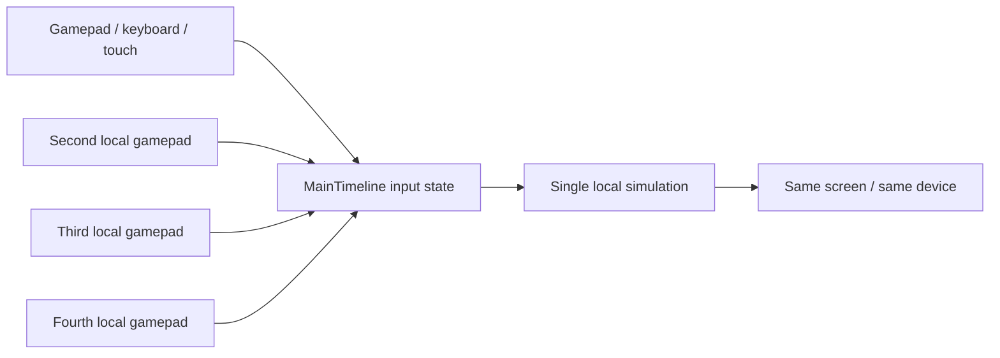

# Networking and Multiplayer Feasibility

## Bottom line

**There is no online gameplay networking in Extra Lives 1.170.64.**

The game's “Multiplayer” feature is **local, same-device multiplayer** using multiple controllers/gamepads. The analyzed code contains no socket, remote-procedure, matchmaking, lobby, or state-replication layer. The only network-capable code is peripheral: ad/config HTTP loading, in-app billing, and opening store/social URLs.

This conclusion is based on a systematic static search of the decompiled ActionScript and the application manifest, not on a runtime packet capture. It is a **verified** absence of the relevant APIs in the exported game code; a native AIR runtime could in principle make connections on behalf of an extension, but no such gameplay path is present in the app code.

## What was searched

Search space:

- `Game_fla/MainTimeline.as` (all game logic);
- all 681 exported AS files;
- `Game-app.xml`;
- `AndroidManifest.xml`;
- APK extension/native-library inventory.

Patterns searched include:

```text
Socket, XMLSocket, WebSocket, NetConnection, NetStream,
NetGroup, RTMFP, RemoteObject, SharedObject, URLStream,
URLLoader, URLRequest, navigateToURL, sendToURL,
LocalConnection, StageVideo, Peer, ServerSocket
```

Results:

| API / pattern | Finding |
|---|---|
| `Socket`, `XMLSocket`, `WebSocket` | none |
| `NetConnection`, `NetStream`, `NetGroup`, `RTMFP` | none |
| `RemoteObject`, RPC/AMF remoting | none |
| `LocalConnection` | none |
| Gameplay state replication/serialization | none |
| `URLLoader` | one ad/instruction text request |
| `navigateToURL` | store/social/web links |
| `SharedObject` | local saves only |
| `File` | local `Characters.txt`, `Frames.txt`, music |
| In-app billing | Distriqt ANE |
| Ads | AdMob/other ad calls in code |

### The only game-code `URLLoader`

```as3
this.onlineFile = new URLLoader(
    new URLRequest("http://www.mdickie.com/ads/extralives_instruction.txt")
);
```

This is an HTTP text fetch for ad/instruction configuration. It does not send player state, receive match state, or maintain a session. The response is parsed into ad-related fields (`adCrossover`, `adType`, etc.) and is not a gameplay transport.

### Manifest permissions

The Android manifest requests `INTERNET`, `ACCESS_NETWORK_STATE`, `ACCESS_WIFI_STATE`, `READ_PHONE_STATE`, `WAKE_LOCK`, storage, and billing permissions. These are consistent with ads, billing, analytics/device identity, and online store links. Permissions alone are not evidence of gameplay networking; the code contains no matching gameplay transport.

### Billing and ads

- In-app billing uses `com.distriqt.InAppBilling` and related Distriqt extensions. Code includes setup, product loading, purchase flow, and upgrade messaging.
- Ad code references AdMob and other ad APIs and fetches a remote instruction file.
- Neither path exchanges game state or player input with another player.

These are **verified** code paths, but they are outside the multiplayer question.

## What “Multiplayer” actually does

The option labels are:

```as3
this.textMultiplayer = new Array("Off", "Versus", "Co-op", "Mystery");
```

The option is cycled with `BrowseOption(..., min = 0, max = 3, cycle = 1)`, so the four labels correspond to values `0..3`.

Behavior:

1. Multiplayer requires gamepad support: the path is gated by `optGamepad > 0` and controller connection state.
2. The game assigns local controller slots via `pControl`, `pController`, and `pGamepad`.
3. `IncludeHuman` (line 20757) selects an existing local entity to hand to another human:
   - **Versus**: prefer a zombie/human opponent slot;
   - **Co-op**: prefer a non-zombie human ally slot;
   - **Mystery**: role logic decides.
4. `GameScreen` sets up the local player slots and controllers. For example, around lines 115419–115428 it checks `optMultiplayer` and `padConnected` to add a second local human.
5. All four players run in the same `MainTimeline`, same frame loop, same world arrays.

There is no server address, session ID, player ID, join/leave protocol, or remote input path. “Versus” and “Co-op” are local modes, not online modes.



## Feasibility of adding online multiplayer

### Hard blockers in the current build

1. **No transport layer.** A network stack must be added (AIR `Socket`/`NetConnection`, a native extension, or an external wrapper).
2. **No session model.** There is no lobby, player identity, reconnect, ready state, or room lifecycle.
3. **No serialization.** Game state is 1,497 variables plus large parallel arrays and `MovieClip` references. `MovieClip`/display objects cannot be serialized directly.
4. **Monolithic simulation.** All state and logic live on one dynamic class; there is no `World`/`Player` boundary to snapshot or replicate.
5. **Frame-order and RNG coupling.** Combat, AI, and animation depend on per-frame random calls and mutation order.
6. **Local-only saves.** There is no account/cloud identity or server validation.

### Feasible approaches

#### Option A — Keep it local (lowest risk)

Keep “Multiplayer” as same-device Versus/Co-op/Mystery. This is the only mode supported by the current architecture and requires no network work.

- **Effort:** none.
- **Compatibility:** exact current behavior.
- **Recommendation:** if the goal is simply to play with another person in the same room, this is already implemented.

#### Option B — Authoritative host, state snapshots (medium-high effort)

One device runs the authoritative simulation; clients send inputs and receive snapshots/events.

Required work:

- Define a compact network state for active entities, projectiles, items, camera-relevant events, and RNG seed/tick.
- Add a server/transport (dedicated process or host device) and a client input channel.
- Handle join-in-progress, disconnect/reconnect, and late-join state transfer.
- Add interpolation/extrapolation for remote entities.
- Keep off-screen world bookkeeping either host-authoritative or synchronized at low frequency.
- Refactor or wrap `MainTimeline` with serialization hooks and deterministic tick boundaries.

Challenges:

- `MovieClip` references and dynamically attached assets are not serializable; only logical state can cross the wire.
- Large per-frame state would be expensive if sent naively. Event replication plus periodic keyframes is more realistic.
- Flash/AIR socket support and platform backgrounding (Android lifecycle) complicate host reliability.

**Assessment:** technically possible as a substantial fork, but not a small patch.

#### Option C — Deterministic lockstep (high risk)

All peers run the same simulation with synchronized inputs and RNG.

Requirements:

- Prove frame-rate and floating-point determinism across devices; AIR/Android may vary.
- Replace or seed all `Rnd`/`RndDec`/`RndOr` calls deterministically.
- Synchronize inputs by tick and handle late input/rollback.
- Ensure all entity creation and animation state is deterministic.

**Assessment:** attractive for a lockstep game, but the code was not designed for it and there is no evidence of cross-device determinism. This is a research project before it is a feature.

#### Option D — Co-op only via a shared host / remote play (medium)

If the goal is “play together” rather than true competitive netcode, a remote-play/streaming wrapper or host-authoritative co-op with a simplified state model is more achievable than full versus netcode.

Still requires session management, input transport, and state sync, but can tolerate more latency and avoid perfect determinism.

### Recommended staged plan if online is required

1. **Instrument and measure.** Add a deterministic tick counter and RNG seed; log state hashes for two runs of the same scenario.
2. **Extract a logical state model.** Define plain data structures for players, NPCs, items, projectiles, and world time; keep `MovieClip`s as presentation only.
3. **Choose authority.** Host-authoritative snapshots are the pragmatic default; lockstep only if determinism is proven.
4. **Add session/transport.** Start with a LAN/direct-IP prototype before matchmaking.
5. **Implement input + snapshot protocol.** Use client input messages, host ticks, keyframe snapshots, and event deltas.
6. **Add interpolation and reconnection.** Remote entity smoothing and late-join snapshot are mandatory for usability.
7. **Add lobby/identity/matchmaking.** Only after the core loop works.
8. **Validate on real Android devices.** Backgrounding, Wi-Fi changes, and touch/gamepad differences will dominate.

### Effort estimate

| Scope | Relative effort | Notes |
|---|---|---|
| Same-device multiplayer | none / already present | no network |
| LAN co-op prototype | high | transport + state extraction + host loop |
| Online versus with matchmaking | very high | determinism or authoritative server + lobby + anti-cheat |
| Cloud saves/accounts | high | separate from real-time multiplayer |

These are engineering judgments, not measured estimates. No network prototype was built during this analysis.

## Security and product considerations

- Any competitive online mode needs server-authoritative validation; the current client owns all state and saves locally.
- The game's local save data can be modified on-device; do not treat it as trusted.
- Ads/billing SDKs already expand the attack surface; a network layer should not reuse ad endpoints or trust client-provided purchase state.
- MDickie's game design is largely offline/sandbox; online multiplayer may not be worth the architectural cost compared with local play.

## Final assessment

| Question | Answer | Confidence |
|---|---|---|
| Does the shipped game support online multiplayer? | No | Verified by static API/code audit |
| Is “Multiplayer” local? | Yes, same-device Versus/Co-op/Mystery | Verified |
| Does it require gamepads? | The multiplayer path is gated by gamepad support | Verified in code; exact device UX needs runtime confirmation |
| Is there any network gameplay state? | None found | Verified absence in exported code |
| Can online be added without major refactoring? | No | Strong inference |
| Is online feasible at all? | Yes, as a substantial fork/prototype | Engineering assessment |
| Best first step | Measure determinism and extract logical state | Recommendation |

See [EVIDENCE-AND-OPEN-QUESTIONS.md](EVIDENCE-AND-OPEN-QUESTIONS.md) for the exact code locations and the limits of this audit.
