# Online Multiplayer Architecture

**Scope:** evidence-based architecture options for adding online play to Extra Lives 1.170.64. No networking is implemented in this phase.

**Inputs:** [DETERMINISM-AND-GAME-LOOP.md](DETERMINISM-AND-GAME-LOOP.md), [LOGICAL-GAME-STATE-MODEL.md](LOGICAL-GAME-STATE-MODEL.md), [DATA-FLOW-AND-DEPENDENCIES.md](DATA-FLOW-AND-DEPENDENCIES.md), and [NETWORKING-AND-MULTIPLAYER-FEASIBILITY.md](NETWORKING-AND-MULTIPLAYER-FEASIBILITY.md).

## 1. Requirements and assumptions

A practical online mode needs to decide:

- **Players:** 1v1 first, then 2–4 player arena or co-op.
- **Session length:** one short match rather than a persistent 200-character campaign.
- **Authority:** who decides hits, health, item ownership, and win conditions.
- **Latency target:** playable at roughly 50–150 ms RTT; not tournament-grade.
- **Platform:** Android/AIR, with no existing game transport.
- **Content:** both peers should use matching `Characters.txt`, `Frames.txt`, and SWF/code versions.
- **Persistence:** local campaign saves should not become authoritative competitive state.

These assumptions favor an **authoritative session** over peer lockstep.

## 2. Non-negotiable constraints from the current build

1. **No transport or session layer exists.**
2. **The simulation is variable-rate and frame-counted**, with no fixed tick or delta time.
3. **Randomness is unseeded and shared with presentation.**
4. **Combat reads render-derived limb geometry.**
5. **State is a monolith of parallel arrays and MovieClips.**
6. **Saves are local and editable.**
7. **There is no input sequence, snapshot, or reconnect model.**

Any architecture must either:

- remove clients' need to reproduce exact simulation (authority), or
- refactor the entire loop and RNG for determinism.

The first is less risky.

## 3. Option comparison

### Option A — Keep local only

**What:** retain same-device Versus/Co-op/Mystery.

- Effort: none.
- Determinism requirement: none.
- Network requirement: none.
- Risk: none.
- Product value: already shipped.

**Verdict:** correct baseline; not an online solution.

### Option B — Remote play / streaming

**What:** run the game on a host/cloud machine and stream video + input.

- Effort: high infrastructure, low game-code change.
- Latency: dominated by video encoding and RTT; poor for a fast fighter unless regional.
- Bandwidth: high and variable.
- Cheat resistance: strong if server-hosted.
- Determinism: irrelevant; one simulation.
- Compatibility: requires a streaming client, not the current APK.

**Verdict:** viable product experiment, not a lightweight netcode addition. It preserves the game exactly but moves the problem to infrastructure.

### Option C — Deterministic lockstep

**What:** every peer runs the same simulation; only inputs (and a seed) cross the network.

- Effort: very high refactor.
- Bandwidth: very low.
- Cheat resistance: poor (each client knows full state; can modify).
- Latency: sensitive to input delay/rollback.
- Requirements: fixed tick, seeded PRNG, deterministic presentation isolation, identical float behavior, stable entity order.
- Current readiness: **not ready**.

**Verdict:** not recommended for the first online version. It would require proving determinism that the current code does not provide.

### Option D — Host-authoritative snapshots + events

**What:** one participant (or a dedicated process) runs the authoritative simulation. Clients send inputs and receive snapshots/events.

- Effort: high but incremental.
- Bandwidth: moderate; can be reduced with delta snapshots and interest management.
- Cheat resistance: moderate (host can cheat; dedicated server stronger).
- Latency: workable with prediction/interpolation.
- Determinism: not required across clients.
- Compatibility: requires an instrumented client/fork and a transport.

**Verdict:** **recommended baseline**.

### Option E — Dedicated authoritative server

**What:** Option D with a server process that no player controls.

- Effort: highest initial infrastructure.
- Cheat resistance: strongest.
- Operations: matchmaking, deployment, monitoring, regional capacity.
- Code reuse: the same simulation core as host-authoritative mode.

**Verdict:** target architecture for competitive play; host mode is the prototype path.

## 4. Comparison table

| Criterion | Local only | Remote play | Lockstep | Host authoritative | Dedicated server |
|---|---|---|---|---|---|
| Game-code change | none | low | very high | high | high |
| New infrastructure | none | very high | medium | medium | high |
| Bandwidth | none | very high | very low | medium | medium |
| Latency tolerance | perfect | poor–medium | medium | good with prediction | good |
| Determinism required | no | no | yes | no | no |
| Cheat resistance | local | strong | weak | host-dependent | strong |
| Reconnect complexity | none | high | medium | medium | medium |
| Best first step | — | product test | research | **prototype** | production |

## 5. Recommended architecture

### 5.1 Shape

```mermaid
flowchart LR
    C1[Client 1 input/prediction] -->|input frames| H[Authoritative host/server]
    C2[Client 2 input/prediction] -->|input frames| H
    C3[Client 3/4] -->|input frames| H
    H -->|snapshots 10-20 Hz| C1
    H -->|snapshots 10-20 Hz| C2
    H -->|reliable events| C3
    H --> S[Session/lobby service]
    H --> P[Persistent profile service optional]
```



Use a **hybrid of snapshots and reliable events**:

- snapshots for continuously changing transform/action state;
- events for discrete facts (hit, damage, death, pickup, spawn, round end);
- reliable ordered control channel for session and events;
- unreliable/latest-state channel for snapshots where available.

### 5.2 Authority boundary

The authority owns:

- match phase and scoring;
- entity spawn/despawn and stable IDs;
- player/NPC positions and actions;
- hit detection, damage, death, grapple state;
- weapon/item ownership and projectile effects;
- world clock/location transitions;
- off-screen character state for campaign modes;
- RNG outcomes that affect gameplay.

Clients own:

- input sampling;
- rendering, animation playback, camera, audio, particles;
- local UI and settings;
- prediction of their own movement;
- interpolation of remote entities.

### 5.3 Fixed authoritative tick

The current `ENTER_FRAME` rate must not be the network clock.

Recommended:

```text
simulation tick: 30 Hz or 60 Hz (choose one)
render: device rate (up to 60 Hz)
snapshot: 10–20 Hz
input: every simulation tick or a small command bundle
```

A fixed tick makes:

- movement reproducible on the authority;
- input sequencing meaningful;
- replay/testing possible;
- snapshot interpolation stable.

The render loop interpolates between snapshots. The simulation does not read wall-clock time.

### 5.4 Input model

Each client sends:

```text
InputCommand {
  matchId
  playerId
  slot
  tick
  sequence
  buttons
  axisX
  axisY
}
```

The authority:

1. validates the player/slot;
2. rejects stale/duplicate sequences;
3. applies the command at the intended tick (or the next available tick);
4. records the last accepted sequence for reconciliation.

Buttons/actions must map to the game's logical actions, not raw device scan codes, so keyboard/touch/gamepad clients behave consistently.

### 5.5 Client prediction and reconciliation

For responsiveness:

- the local client predicts its own movement using the same rules;
- the authority periodically sends the authoritative state and last processed input sequence;
- the client re-applies unacknowledged inputs from the authoritative state;
- remote entities are interpolated, not predicted, unless the design requires it.

Prediction should be limited to movement/animation initially. Do not predict damage, death, grapples, or item ownership in Prototype A.

### 5.6 Snapshots and deltas

A full snapshot includes all active entities. A delta includes changed fields/entities since the last acknowledged baseline.

Recommended baseline:

- full snapshot on join, reconnect, area change, and every N seconds;
- delta snapshots at 10–20 Hz;
- reliable events for damage/death/spawn/despawn/pickup;
- snapshot sequence numbers and authority tick;
- client acknowledges the latest applied snapshot.

Interest management:

- only the active area and nearby entities are replicated at high frequency;
- off-screen characters are summarized or synchronized on area entry;
- distant effects may be dropped.

### 5.7 Entity interpolation

Remote entities should render slightly in the past (for example 100 ms) and interpolate between two snapshots. This hides jitter and packet loss.

Do not interpolate:

- discrete events (a hit either happened or did not);
- ownership changes;
- death/round transitions.

Use events to correct the interpolated presentation immediately.

### 5.8 Transport

The game code currently has no gameplay socket API. Practical options:

1. **Native extension with UDP** — best fit for real-time action; more platform work.
2. **WebSocket/TCP via a native extension or external relay** — easier for a prototype, but head-of-line blocking hurts under loss.
3. **External companion/relay process** — useful for LAN tests and instrumentation.
4. **WebRTC data channel** — viable with an ANE/native bridge; adds signaling complexity.

For a LAN prototype, TCP/WebSocket may be acceptable to validate state and input flow. For production competitive play, UDP or a reliability layer over UDP is preferable.

**Constraint:** AIR's `Socket`/`XMLSocket` are TCP-style APIs. AIR also exposes `DatagramSocket` for UDP in supported runtimes, and a native extension can provide a custom reliability layer, but the shipped app uses none of these. A platform spike is required to choose between base `DatagramSocket`, a native UDP extension, or a TCP/WebSocket prototype. Do not assume `Socket` gives game-grade unreliable transport.

### 5.9 Session and content handshake

Before spawning:

```text
client -> server: protocolVersion, appVersion, contentManifest,
                  playerId, displayName, capabilities
server -> client: accepted/rejected, sessionId, slot, rules, snapshot
```

Reject mismatched:

- code/SWF version;
- `Characters.txt` hash;
- `Frames.txt` hash;
- protocol version;
- incompatible mods.

This is essential because frame/costume data influences combat geometry.

## 6. Scope by game mode

### Arena / Deathmatch (recommended first)

- One active area.
- Small player count.
- Existing character stats and melee combat.
- No campaign persistence, vehicles, or world travel.
- Easiest to define authority and snapshots.

### Survival co-op

- Host owns waves, spawns, NPC AI, and shared score.
- More entities and longer sessions.
- Need join-in-progress and reconnect.
- Still one area at a time.

### Campaign / open-world co-op

- Hardest: 200-character global state, area transitions, promos, saves, time, stocks.
- Requires host-authoritative world state and a persistence policy.
- Not appropriate for the first prototype.

## 7. Security model

- Never trust client-reported positions, hits, health, or inventory.
- The authority validates attack range, cooldowns, line/ground constraints, and ownership.
- Treat local `SharedObject` saves as untrusted input.
- Authenticate players for online identity; do not reuse ad/billing endpoints.
- Rate-limit input and event messages.
- Use server time for match timers.
- Log authority tick, input sequence, and damage events for dispute/debug.
- A host-device model still lets the host cheat; disclose this or use dedicated servers for ranked play.

## 8. Failure and lifecycle handling

| Event | Required behavior |
|---|---|
| Client disconnect | Authority keeps entity for grace period or converts to AI/idle; notify others |
| Reconnect | Re-authenticate, send full snapshot, resume slot |
| Host disconnect | Match ends or migrates to a new authority (migration is complex; avoid initially) |
| Packet loss | Snapshot interpolation/extrapolation; reliable events retransmit |
| Android background | Pause input, mark client away, authority may idle the entity |
| Area transition | Freeze input, load new area, full snapshot |
| Version mismatch | Reject before match |
| Corrupt save | Do not let it define authoritative match state |

## 9. Migration plan from the shipped build

### Phase 0 — Measurement

- deterministic tick counter;
- seed/RNG instrumentation;
- state hash and input log;
- profile active entity counts and frame cost.

### Phase 1 — Logical extraction

- plain entity/world records;
- stable IDs;
- separate simulation mutations from rendering;
- remove reliance on MovieClip geometry for authority decisions or expose a pure hit-geometry function.

### Phase 2 — Local headless authority

- run the simulation without rendering on one process;
- feed synthetic inputs;
- verify state transitions and snapshots.

### Phase 3 — LAN prototype

- one authority, one client;
- movement sync only (Prototype A);
- then melee combat (Prototype B).

### Phase 4 — Online session

- lobby, matchmaking, reconnect;
- remote playtest;
- anti-cheat and telemetry.

### Phase 5 — Product hardening

- dedicated servers if competitive;
- regional deployment;
- moderation/abuse handling;
- save/account migration.

## 10. Why not lockstep first

Lockstep would be attractive on paper because it sends little data. For this codebase it requires all of the following before it can work:

- deterministic fixed tick;
- deterministic PRNG with all cosmetic draws controlled;
- deterministic entity ordering;
- identical floating-point behavior;
- pose/hit geometry that does not depend on rendering;
- replay verification across devices.

That is a research project on top of a reverse-engineered monolith. A host-authoritative prototype delivers playable networking with fewer unknowns and leaves the door open to a future deterministic core.

## 11. Recommendation

**Build host-authoritative snapshots/events, starting with a one-area arena and melee-only combat.**

Specifically:

1. Fixed 30 Hz authority tick.
2. Input commands with sequence numbers.
3. 15 Hz snapshot baseline plus reliable combat events.
4. Client-side movement prediction and remote interpolation.
5. Host computes hits using its own pose geometry.
6. Content hash handshake.
7. LAN first; online second; dedicated servers only if competitive integrity demands it.

## 12. Open questions

1. Can the decompiled AS3 be recompiled into a testable AIR build? **Unknown; prerequisite for any in-client prototype.**
2. What active-entity count and snapshot size are typical in the busiest arena? **Needs profiling.**
3. Does a native UDP extension fit the existing Android packaging and AIR version? **Needs a platform spike.**
4. How much authority can be added without extracting the simulation from `MainTimeline`? **Unknown; likely requires a wrapper/fork.**
5. Is host migration required for the product, or can host loss end the match? **Product decision.**
6. Should co-op share campaign progression, and if so, which host owns the save? **Product/design decision.**

See [ONLINE-MULTIPLAYER-PROTOTYPE.md](ONLINE-MULTIPLAYER-PROTOTYPE.md) for the minimal implementation plan.
